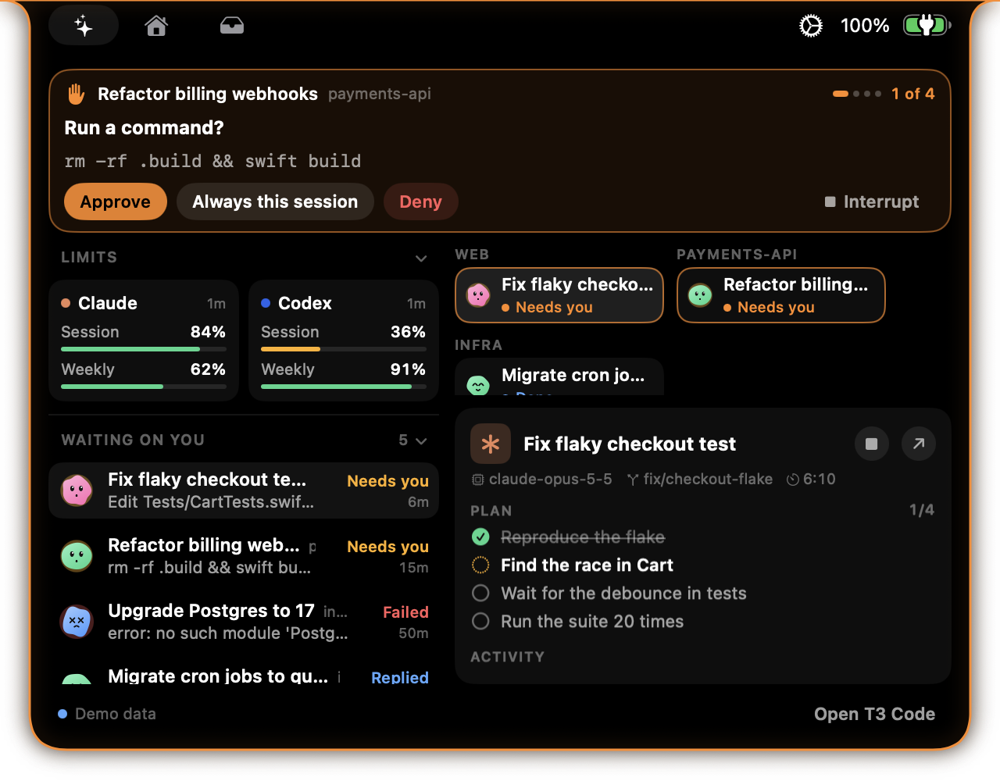

<p align="center">
  <picture>
    <source media="(prefers-color-scheme: dark)" srcset="assets/readme/banner-dark.svg">
    
  </picture>
</p>

<p align="center">Your T3 Code agents, right in your Mac's notch.</p>

<p align="center">
  
</p>

<p align="center">
  
</p>

T3 Isle is a free, open-source notch app for macOS. It's a fork of [boring.notch](https://github.com/TheBoredTeam/boring.notch), so everything boring.notch does still works: music controls, the calendar, HUDs, the shelf and the rest. On top of that, it shows what your [T3 Code](https://t3.codes) agents are up to and lets you answer them without switching windows.

I'd been using boring.notch along with [Alcove](https://tryalcove.com/), [DynamicLake Pro](https://www.dynamiclake.com/) and [NotchNook Pro](https://getnotchnook.com/), and paying for those last three got old. So I forked boring.notch and made my own, starting with T3 Code since my whole workflow revolves around it (T3 Code is goated).

## What's in the notch

- **An inbox.** Threads waiting on you show up as faces, and threads that are still working show up greyed out. Open the notch to see them grouped, each with a live status line. Click one to jump to it in T3 Code.
- **Quota rings.** See how much of each sub you have left. When an agent needs you, they turn into a question count.
- **Approvals and questions.** When an agent asks for something, the notch opens and turns orange. Approve, deny, pick an option or type an answer right there. You can also interrupt a running turn.
- **Live plans.** See the agent's plan as a checklist, plus a short feed of what it just did.
- **No subagent clutter.** Subagent threads stay hidden unless you turn them on in settings.

## Requirements

- macOS 14 or later
- [T3 Code](https://t3.codes) running on the same Mac (remote machines aren't supported yet)

## Build and run

There are no releases yet, so for now you build it from source. Open `boringNotch.xcodeproj` in Xcode and run the `boringNotch` scheme, or use the terminal:

```sh
xcodebuild -project boringNotch.xcodeproj -scheme boringNotch \
  -configuration Debug -derivedDataPath build build
open "build/Build/Products/Debug/T3 Isle.app"
```

T3 Isle finds T3 Code on its own and signs in with T3's command-line tool. The session token stays in a private file in T3 Isle's Application Support folder that only your account can read.

Want to poke around without real agents? Quit T3 Isle if it's running, then launch it with `--demo` for made-up threads, questions and quota. Demo mode never talks to T3.

```sh
open "build/Build/Products/Debug/T3 Isle.app" --args --demo
```

Tests and the details of how T3 Isle talks to T3 Code are in [CONTRIBUTING.md](CONTRIBUTING.md#working-on-t3-isle).

## What's next

The plan is to borrow features from my favorite other notch apps and add a few of my own, like a prompter, live activities, clipboard history and a little Pomodoro timer. Honest note: ironically, a lot of this is already covered by [Raycast](https://www.raycast.com/).

Feel free to open pull requests or open issues with recommendations.

## Credits

- Fork of [boring.notch](https://github.com/TheBoredTeam/boring.notch) (GPL-3.0) by TheBoredTeam, modified for T3 Isle. Huge thanks to them.
- T3 UI and integration partly derived from [t3-island](https://github.com/sdlyy/t3-island) by sdlyy (MIT).
- T3 integration inspired by T3Notch by zortos293.

Licenses for included code are in [THIRD_PARTY_LICENSES](THIRD_PARTY_LICENSES).

T3 Isle is an independent project, not affiliated with T3 or T3 Code.

## License

[GPL-3.0](LICENSE). Fork away (just keep it GPL).
