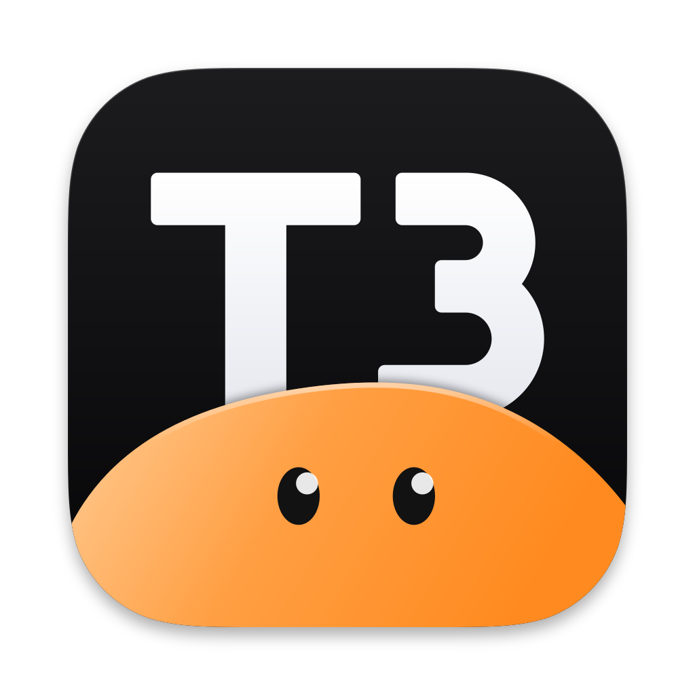

# T3 Isle

T3 Isle is a free, open-source macOS notch app. It is a fork of [boring.notch](https://github.com/TheBoredTeam/boring.notch) with a first-class [T3 Code](https://t3.codes) integration.

Everything boring.notch does still works: music controls, HUDs, calendar, battery and the shelf. On top of that, the notch becomes a live view of your T3 Code agents.

## What it adds

- **Inbox in the notch.** Faces for threads waiting on you, greyed faces for working threads, and quota rings for Claude and Codex. Open the notch for quota cards and the threads, grouped as waiting on you, working and snoozed, each with a live status line. Snooze or settle threads without leaving the notch. Click a thread to open it in T3 Code.
- **Answer approvals and questions in the notch.** When an agent asks for approval or input, the notch opens on its own and turns orange. Questions come one at a time. Approve, deny, pick an option or type an answer. You can also interrupt a running turn.
- **Live plan and activity.** For the selected agent: provider, model, branch and run time, its plan as a checklist, and a short feed of its latest steps. With several agents running, each gets a card, grouped by project.

## Requirements

- macOS 14 or later
- [T3 Code](https://t3.codes) running on the same Mac. Remote machines are not supported yet.

## Build

Open `boringNotch.xcodeproj` in Xcode and run the `boringNotch` scheme, or:

```sh
xcodebuild -project boringNotch.xcodeproj -scheme boringNotch -configuration Debug build
```

The T3 data layer is a Swift package in `T3IsleCore/`. Its tests run with:

```sh
swift test --package-path T3IsleCore
```

To try the T3 views without live agents, launch the app with `--demo`:

```sh
open "path/to/T3 Isle.app" --args --demo
```

Demo mode uses made-up agents, questions, plans and quota, and never contacts T3.

## How it talks to T3 Code

T3 Isle uses T3 Code's local server on this Mac. It finds the server in `~/.t3/userdata/server-runtime.json` (falling back to `http://127.0.0.1:3773`) and signs in with T3's own command-line tool (`t3 auth session issue`), asking only for the `orchestration:read` and `orchestration:operate` scopes. The session token is stored in the Keychain.

- Threads, questions and approvals stream live over T3's WebSocket API (`orchestration.subscribeShell`). Thread details (plan, activity, question text) come from `/api/orchestration/threads/<id>/bounded`.
- Answers, approvals, interrupts, snooze and settle are sent as T3 orchestration commands (`runtime-request.respond`, `thread.stop`, `thread.snooze`, `thread.settle`, …).
- Usage limits come from `~/.t3/caches/<provider>.json`.
- Clicking a thread opens `t3code://threads/<environment-id>/<thread-id>`.

Set `T3CODE_HOME` to use a different T3 data directory. Turning off "Snooze and settle threads" in Settings revokes the session.

## Credits

- Fork of [boring.notch](https://github.com/TheBoredTeam/boring.notch) (GPL-3.0) by TheBoredTeam. Modified for T3 Isle.
- T3 UI and integration partly derived from [t3-island](https://github.com/sdlyy/t3-island) by sdlyy (MIT).
- T3 integration inspired by T3Notch by zortos293.

See [THIRD_PARTY_LICENSES](THIRD_PARTY_LICENSES) for the licenses of included code.

## Disclaimer

Independent project, not affiliated with T3 or T3 Code.

## License

GPL-3.0, see [LICENSE](LICENSE).
